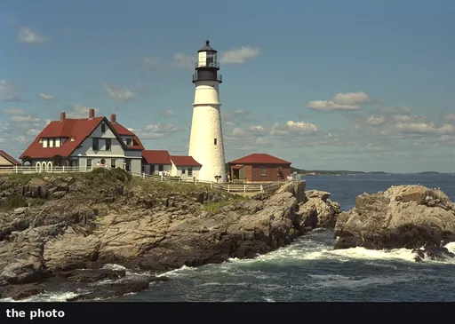
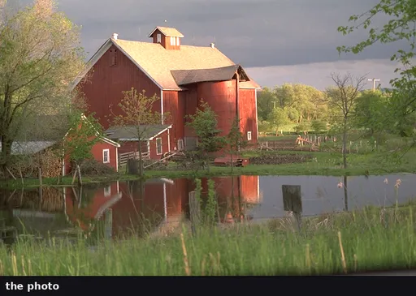
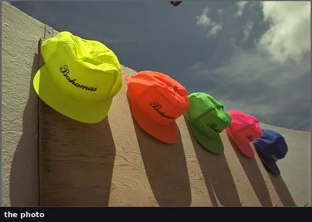
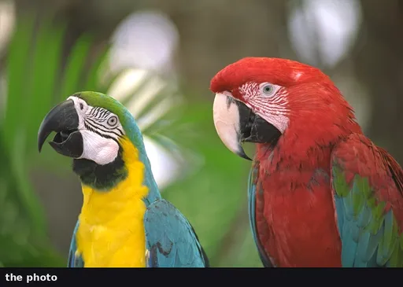

# mirage-gaussifier-mcp

An [MCP](https://modelcontextprotocol.io) server that turns a photo into an editable image made
of Gaussians, and lets an assistant edit it: swirl, magnify, recolour, duplicate, tilt parts out
of the picture into 3D, and record the whole editing process as an animation.

- [Gaussifier](https://github.com/Gaussifier/gaussifier) places the initial Gaussians in a
  fraction of a second.
- [MiraGe](https://github.com/waczjoan/MiraGe) (ICML 2025) fits flat 3D Gaussians on the image
  plane. Each one is controlled by a triangle, so any edit is a deformation of those triangles
  and the picture follows.



An AI agent edited this photo through the MCP server: a quiet afternoon at the lighthouse gets a
sunset, blue roofs and a whirlpool; then the lighthouse steps forward, gets a free twin, and grows
a big glowing head to stay the taller one. Every step is one MCP tool call;
[how the agent edited it](docs/demo/lighthouse_steps.md) lists them, and
[the plan](docs/demo/lighthouse_plan.json) replays it. More examples are [below](#examples).

## Examples

Each example below was also edited by an AI agent through the MCP server, given only the photo
and a theme: it designed the sequence, built the selections, chose every edit and caption, and
checked the previews it got back. Each write-up lists the tool calls, and its plan replays them.

### The same place through the seasons



One farm photo walked from summer through autumn into winter by recolouring only what changes
with the seasons (sky, trees, grass, pond and roof), while the barn keeps its red; the first snow
is made of real splats, copied from the sky, shrunk to flakes and dropped through the picture.
[How the agent edited it](docs/demo/barn_steps.md).

### Colour-way catalogue



A designer's colour exploration on a product photo: each cap is isolated and recoloured on its
own into an earth-tone range with a deep teal feature cap; the feature cap is lifted forward and
the view turns like a product turntable; then the rest becomes a tonal navy range around it.
[How the agent edited it](docs/demo/hats_steps.md).

### A picture made of Gaussians



What only a Gaussian image can do: the red macaw flies apart into its splats, is repainted while
the pieces are in the air, flies back together as a blue macaw, and steps out of the picture
plane as the view turns. [How the agent edited it](docs/demo/parrots_steps.md).

## How it works

1. **Gaussify.** Gaussifier's equal-mass placement of the image becomes MiraGe's initial point
   cloud on the image plane, and MiraGe fits it with a mirror camera (about 15 s for 3000
   iterations of a 768×512 image on an RTX 5090). Starting from Gaussifier gives a compact
   model: on Kodak 23 at 3000 iterations it ends with 81k Gaussians (40.9 dB), against 172k
   (47.2 dB) from MiraGe's default random start.
2. **Edit.** Each Gaussian is a triangle (its centre and two scaled axes). Selections pick
   Gaussians by region or colour; edits move the triangle vertices (or change colour and
   opacity), and the renderer rebuilds every Gaussian from its triangle. Edits stack, can be
   undone, and each one takes a strength from 0 to 1, so it can be animated.
3. **Record.** While recording, every edit is captured as a short eased animation with a
   caption. The recording opens with the Gaussians growing from dots into the photo and can end with
   a 3D turn of the result.

## Installation

Requirements: Linux, an NVIDIA GPU, CUDA 12.8 or newer with `nvcc`, CMake, git, curl and
[uv](https://docs.astral.sh/uv/).

```bash
git clone <this repository> mirage-gaussifier-mcp
cd mirage-gaussifier-mcp
bash scripts/setup.sh
```

`scripts/setup.sh` fetches MiraGe (pinned commit, with two small compatibility fixes for current
compilers and Pillow) and Gaussifier v0.12.0 with its released weights into `third_party/`,
builds the CUDA extensions and Gaussifier's runtime for the local GPU, and creates the
environment.

## Use it from an MCP client

The server speaks MCP over stdio:

```json
{
  "mcpServers": {
    "mirage-gaussifier": {
      "command": "uv",
      "args": ["run", "--directory", "/path/to/mirage-gaussifier-mcp", "mirage-gaussifier-mcp"]
    }
  }
}
```

Put this in your client's MCP configuration (for example `.mcp.json` in a project, or the
desktop app's settings). Then ask, for example: *"Gaussify kodim23.png, make the left parrot
green, swirl the right one, and record it as an animation."*

To script it without a client, `scripts/mcp_session.py` runs a JSON list of tool calls in one
session and saves every preview:

```bash
uv run python scripts/mcp_session.py docs/demo/<name>_plan.json --out previews/
```

## Tools

| Tool | What it does |
|---|---|
| `gaussify_image` | Image → editable Gaussian image (`init="gaussifier"` or `"random"`, `iterations`, `max_side`). Reuses an existing fit unless `refit`. |
| `render` | Current result, optionally with the image plane turned in 3D (`yaw`, `pitch`). |
| `select_region` | Name a set of Gaussians: `box`, `ellipse`, `polygon` (fractions of the image), `color` (`rgb`, `tolerance`), `mask_image`, `all`; combine with `add` / `subtract` / `intersect`. Returns the count and a highlighted preview. |
| `edit` | Apply one edit to a selection (below). |
| `list_operations` | The edits and their parameters. |
| `undo`, `reset`, `history` | Edit stack. While recording, `undo` is recorded as the edit running backwards. |
| `start_recording`, `stop_recording` | Record the editing process as an animated WebP or GIF, chosen by the file extension (intro, captions, optional 3D finale). |
| `animate_edit`, `orbit` | Loop one edit, or turn the result in 3D, as an animation. |
| `export_pseudomesh`, `import_pseudomesh` | The triangles as an OBJ, to deform in Blender and bring back (MiraGe's workflow). |

Edits: `translate`, `rotate`, `scale`, `flip`, `bulge` (magnify or pinch), `swirl`, `wave`,
`recolor` (hue, saturation, brightness, tint), `fade`, `duplicate`. Positions and sizes are
fractions of the image.

Edits that only a picture made of Gaussians allows:

- `scatter`: the selected Gaussians fly apart one by one in 3D and dissolve; `undo` brings them
  back together (recorded as a reassembly).
- `shrink_splats`: every Gaussian shrinks about its own centre, so the picture turns into the
  splats it is made of.
- `lift`, `tilt3d`, `fold`, `ripple3d`: move parts of the picture out of the image plane, in depth.
- `camera`: a gentle view move (yaw, pitch, zoom) that shows that depth, as a recordable step.

Limits: moving or shrinking a region leaves an empty (black) area behind it, since nothing is
inpainted; region selections include the background inside them, so intersect a region with a
colour selection (or use a polygon) to isolate an object.

## Licences

This repository's code is MIT licensed. MiraGe, which `scripts/setup.sh` downloads and this
server imports, is distributed under its authors' Gaussian-Splatting licence for
non-commercial research and evaluation use only (see `third_party/MiraGe/LICENSE.md`), and so
is any use of this server with it. Gaussifier is used through its public release.
