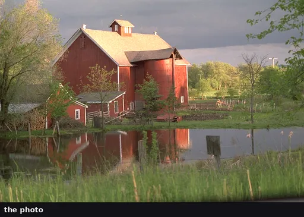

# Barn demo



**Edited by an AI agent.** An AI agent made every edit below by calling this MCP server's tools:
given the image and the theme, it designed the sequence, built the selections, picked the
parameters and captions, and checked the previews the tools returned before settling on the plan.

**Image.** Kodak test image 22 (a red barn by a pond in a field, 768×512), stored as
`data/barn/barn.png` and fitted with 235,885 Gaussians.

**Use case.** The same place at different times of year: one photo of a farm is walked from
summer through autumn into winter by recolouring only the parts that change with the seasons
(sky, trees, grass, pond and roof), and the first snow falls as real splats copied from the sky.

Run it with

```bash
curl -L --create-dirs -o data/barn/barn.png https://r0k.us/graphics/kodak/kodak/kodim22.png
uv run python scripts/mcp_session.py docs/demo/barn_plan.json --out previews/barn
```

The replay writes `previews/barn/barn.webp`; the one shown here is `docs/demo/barn.webp`
(512 px wide, 257 frames at 20 fps, about 13 s, 2.3 MB, animated WebP).
`barn_keyframes.png` shows six of its frames.

## Selections

| Selection | How it is built |
|---|---|
| `green` | `shape="color"` with five greens and yellow-greens, joined with `mode="add"` (from deep shadow `[0.13, 0.16, 0.06]` to sunlit `[0.8, 0.78, 0.45]`, tolerance 0.1 to 0.17): all vegetation, including its reflection in the pond |
| `trees` | the same five colours, then `mode="subtract"` with three polygons: the lawn band behind the pond, the foreground grass and the reeds on the right. What is left is the trees and their reflections |
| `grass` | the same five colours, then `mode="subtract"` with a polygon over everything above the lawn line and a polygon over the pond band |
| `sky` | six greys of the storm sky (`shape="color"`, tolerance 0.08 to 0.12), plus a box over the top strip (`y` below 0.06, between the two trees) for a few dark, off-colour Gaussians along the top edge, minus the five greens, then `mode="intersect"` with a box above the barn's eaves, so the grey shed roofs and the pond are left out |
| `pond` | a polygon over the reeds minus the five greens, then `mode="add"` with a polygon over the whole pond band (water, reflections and all) |
| `roof` | a 15-point polygon along the main roof and the lower roof, plus a 6-point polygon over the cupola's cap only, then `mode="subtract"` with the barn red and three sky greys. The cupola's walls and the sky above the ridge stay out |
| `snow0`, `snow1`, `snow2` | three thin colour slices of the sky (`[0.6, 0.6, 0.63]`, `[0.45, 0.46, 0.5]` and `[0.75, 0.72, 0.75]`, tolerance 0.045 to 0.065), each intersected with the sky box: 701, 546 and 920 Gaussians scattered over the sky |
| `flakes` | made after the three copies below: a box above the picture (`y` from -2 to -0.06), which holds only the 2,167 copies |

All but `flakes` are made before any edit. A selection is a set of Gaussians, so `green` still
points at the trees after autumn has turned them orange, and the copies made later are in no
earlier selection.

## Steps

| # | Tool | Selection | Op and params | Caption |
|---|---|---|---|---|
| a | `edit` | `snow0`, `snow1`, `snow2` | `duplicate` dy -0.4, -0.73 and -1.06 (one call each) | *not recorded*: three copies parked above the picture, one above the other |
| b | `edit` | `flakes` | `shrink_splats` factor 0.22 | *not recorded*: the copies become small dots |
| c | `edit` | `flakes` | `recolor` saturation 0, tint `[0.97, 0.98, 1.0]`, tint_strength 1 | *not recorded*: the dots turn white |
| 0 | `start_recording` | | `frames_per_edit=14, hold_frames=10, intro=True` | *the photo*, then the Gaussians growing in |
| 1 | `edit` | `sky` | `recolor` tint `[0.55, 0.75, 1.0]`, tint_strength 0.5, brightness 1.15 | Summer: the storm clears |
| 2 | `edit` | `green` | `recolor` saturation 1.35, hue 12, brightness 0.92 | High summer, deep green |
| 3 | `edit` | `grass` | `recolor` tint `[1.0, 0.8, 0.4]`, tint_strength 0.5, saturation 0.9 | Late summer: the field turns gold |
| 4 | `edit` | `trees` | `recolor` hue -42, saturation 1.35 | Autumn: the leaves turn |
| 5 | `edit` | `all` | `recolor` saturation 0.6, brightness 0.95, tint `[0.46, 0.5, 0.6]`, tint_strength 0.3 | Winter: cold, grey light |
| 6 | `edit` | `flakes` | `scatter` strength 0.06, toward 0.2, gravity 1.06, fade 0, seed 3 | First snow |
| 7 | `edit` | `green` | `recolor` saturation 0.1, brightness 1.4, tint `[0.75, 0.78, 0.85]`, tint_strength 0.8 | Snow on the trees and field |
| 8 | `edit` | `pond` | `recolor` saturation 0.15, brightness 1.3, tint `[0.72, 0.8, 0.92]`, tint_strength 0.85 | The pond freezes over |
| 9 | `edit` | `roof` | `recolor` saturation 0, tint `[0.6, 0.62, 0.66]`, tint_strength 0.95 | Snow on the roof |
| 10 | `stop_recording` | | `fps=20, orbit_finale=False, width=512` | |

## Tricks

- **Snow made of splats.** The flakes are real Gaussians: thin slices of the sky are copied
  (`duplicate`) to just above the picture, where the camera does not see them, then shrunk to
  dots and whitened, all before the recording starts. In step 6, `scatter` with `gravity` 1.06
  drops each layer by one picture height, so the three stacked copies land spread over the
  whole frame, with a little random drift (`strength`) and depth (`toward`). With `fade` 0 the
  flakes stay in the air for the rest of the recording.
- **Copies are easy to pick out.** A copy is in no selection made before it, and parking the
  copies outside the picture lets a plain box select them and nothing else.
- **Plan the stack.** Edits stack, so each season builds on the last. The cold, grey light of
  step 5 dulls the autumn orange to the brown of dead leaves before the snow, and it also cools
  the barn red and the waiting flakes.
- **Colour first, then carve by region.** Trees and grass have the same colours, so both start
  from the same five-colour union and are split by polygons along the lawn line and the pond.
  The tree reflections in the pond count as trees, so they turn with the trees.
- **Reflections come along.** The pond selection covers the reflections too, so freezing it
  turns the mirrored barn and trees into pale ice instead of leaving a summer reflection.
- **Tint scales with brightness.** The tint is multiplied by twice each Gaussian's grey level,
  so on the sunlit roof a tint near 0.6 already gives white snow, while dark grass stays darker.
  The snow on the field therefore also raises the brightness (1.4), so the field reads as
  white rather than grey.
- **Keep the selection off the sky.** Large, soft sky Gaussians reach over the ridge. The roof
  polygon follows the ridge closely, skips the cupola's walls and subtracts the sky greys, so
  the snow stays on the roof.
- **No holes.** Every edit except the snow is a recolour, and the snow only moves copies.

## Limitations seen here

- Winter is a recolour, not new content: the trees keep their leaves (frosted rather than bare),
  and the barn walls stay red with no snow on ledges.
- The flakes keep the shapes of the sky Gaussians they were copied from, so a few are long
  streaks rather than round dots, and the ones moved toward the viewer look larger and softer.
- `scatter` moves its splats on an accelerating path, so the snow arrives in the second half
  of its step and then hangs still in the air instead of drifting on.
- The frozen pond keeps the light-and-dark pattern of the reflections, so the ice shows pale
  streaks where the white trim and the sky were mirrored.
- Falling leaves were tried for autumn (scattering part of the trees), but the leaves are too
  small to see at this size and the gaps they leave show as dark spots in the pond.
