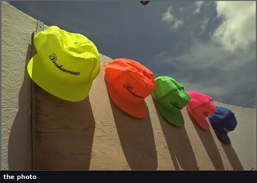

# Hats demo



**Edited by an AI agent.** An AI agent made every edit below by calling this MCP server's tools:
given the image and the theme, it designed the sequence, built the selections, picked the
parameters and captions, and checked the previews the tools returned before settling on the plan.

**Image.** Kodak test image 3 (five neon caps on a wooden board, 768×512), stored as
`data/hats/hats.png` and fitted with 123,561 Gaussians.

**Use case.** A colour-way catalogue: a designer tries product colour variations on a real
product photo. Each cap is isolated and recoloured on its own into an earth-tone range with a
deep teal feature cap, the feature cap is lifted forward and turned like a product on a
turntable, and the other four caps then switch to a tonal navy range around it.

Run it with

```bash
curl -L --create-dirs -o data/hats/hats.png https://r0k.us/graphics/kodak/kodak/kodim03.png
uv run python scripts/mcp_session.py docs/demo/hats_plan.json --out previews/hats
```

The replay writes `previews/hats/hats.webp`; the one shown here is `docs/demo/hats.webp`
(512 px wide, 241 frames at 14 fps, about 17 s, 1.8 MB, animated WebP).
`hats_keyframes.png` shows six of its frames.

## Selections

Each cap is a colour selection (`shape="color"`, then more colours with `mode="add"`)
intersected (`mode="intersect"`) with a polygon of 11 to 13 points traced around that cap. Then
two board colours are subtracted (`mode="subtract"`: sunlit board `[0.72, 0.59, 0.42]` 0.1 and
board shadow `[0.29, 0.22, 0.14]` 0.07), and finally the same polygon shrunk to 80% about its
centre is added (`mode="add"`), which picks up everything well inside the cap whatever its
colour: the lettering, the seams and blended shades.

| Selection | Colours (rgb, tolerance) | Region |
|---|---|---|
| `yellow` | lit `[0.85, 0.92, 0.2]` 0.3, shade `[0.55, 0.57, 0.05]` 0.25, highlight `[0.95, 1.0, 0.55]` 0.3, clipped `[1.0, 1.0, 0.1]` 0.25, deep shade `[0.37, 0.33, 0.1]` 0.1 | 13-point polygon around the big left cap |
| `orange` | lit `[0.7, 0.22, 0.08]` 0.3, highlight `[1.0, 0.5, 0.35]` 0.25, clipped `[1.0, 0.25, 0.05]` 0.25, seams `[0.35, 0.1, 0.04]` 0.15, lettering `[0.05, 0.05, 0.05]` 0.15 | 12-point polygon around the second cap (the feature cap) |
| `green` | lit `[0.4, 0.6, 0.15]` 0.3, highlight `[0.65, 0.8, 0.4]` 0.2, shade `[0.2, 0.3, 0.08]` 0.15, top `[0.55, 0.88, 0.42]` 0.2, rim `[0.3, 0.75, 0.2]` 0.2, pale `[0.45, 0.73, 0.35]` 0.15 | 11-point polygon around the third cap |
| `pink` | lit `[0.7, 0.2, 0.25]` 0.3, highlight `[0.92, 0.35, 0.45]` 0.2, clipped `[1.0, 0.2, 0.35]` 0.25, seams `[0.4, 0.1, 0.14]` 0.15, pale `[0.97, 0.37, 0.53]` 0.15 | 11-point polygon around the fourth cap |
| `blue` | `[0.2, 0.22, 0.4]` 0.2, dark `[0.1, 0.1, 0.2]` 0.12, lit `[0.35, 0.4, 0.6]` 0.2 | 11-point polygon around the small right cap |
| `range` | the `blue` colours, intersected with the `blue` polygon; then the `yellow`, `green` and `pink` colours added | one 47-point polygon around all five caps, minus the `orange` polygon, then the board colours subtracted and the four shrunk polygons added |

All six are made before the first edit, from the original colours. A selection is a set of
Gaussians, so `orange` still points at the second cap after it has been recoloured and lifted.

## Steps

| # | Tool | Selection | Op and params | Caption |
|---|---|---|---|---|
| 0 | `start_recording` | | `frames_per_edit=14, hold_frames=6, intro=True` | *the photo*, then the Gaussians growing in |
| 1 | `edit` | `orange` | `recolor` saturation 0, tint `[0.12, 0.4, 0.42]`, tint_strength 0.9 | Range 1: deep teal feature cap |
| 2 | `edit` | `green` | `recolor` saturation 0, tint `[0.62, 0.68, 0.38]`, tint_strength 0.9 | Olive |
| 3 | `edit` | `pink` | `recolor` saturation 0, tint `[0.45, 0.1, 0.17]`, tint_strength 0.9 | Wine |
| 4 | `edit` | `blue` | `recolor` saturation 0, tint `[1.5, 1.3, 1.0]`, tint_strength 0.9 | Sand |
| 5 | `edit` | `yellow` | `recolor` saturation 0, tint `[0.62, 0.42, 0.12]`, tint_strength 0.9 | Mustard |
| 6 | `edit` | `orange` | `lift` amount 0.04 | Bring the feature cap forward |
| 7 | `edit` | `all` | `camera` yaw -12, pitch -3, zoom 1.15 | Turn it, like a turntable |
| 8 | `edit` | `all` | `camera` yaw 10, pitch 3, zoom 1.15 | and the other way |
| 9 | `edit` | `all` | `camera` yaw 0, pitch 0, zoom 1 | Back to the catalogue view |
| 10 | `edit` | `range` | `recolor` saturation 0, tint `[0.2, 0.25, 0.42]`, tint_strength 0.9 | Range 2: tonal navy, teal kept |
| 11 | `stop_recording` | | `fps=14, orbit_finale=False, width=512` | |

## Tricks

- **Colour and region together.** Each cap is a colour selection intersected with a polygon.
  The orange and pink caps are close in colour, and the blue cap is close to the sky and the
  shadows, so neither the colour nor the polygon alone would isolate a cap.
- **Several colours per cap, plus the core.** One colour with a large tolerance missed the
  clipped highlights, the shaded brims and the dark seams, which then kept their neon colour
  after a recolour. Each cap adds four to six colours, and the shrunk polygon adds the core of
  the cap whatever its colour. Without the core, the lettering stayed on the image plane when the
  feature cap was lifted and showed as a double "Bahamas" in the turned view.
- **No sky halo.** The blue cap's colours also match the grey-blue sky. In `range` they are held
  to the blue cap's own outline before the other caps' colours are added, so the navy recolour
  changes no sky Gaussians next to the caps.
- **Recolour by grey level.** `saturation 0` removes the neon colour and the tint then sets the
  new one, scaled by each Gaussian's own brightness, so folds and shading survive. The dark blue
  cap needs tint values above 1 to reach a light sand. In the navy step the caps keep their
  different brightness, which gives the range its light-to-dark tones.
- **Lift, then turn.** A `lift` barely shows from the front. The `camera` sweep afterwards turns
  the whole picture by 12° one way and 10° the other, and the teal cap visibly stands in front of
  its neighbours, like a product on a turntable. The zoom of 1.15 keeps the image edges out of
  view, and the last camera step returns to the straight view.
- **No holes.** Every edit stays in place (recolour) or moves the cap toward the viewer (lift),
  so no empty background is revealed.

## Limitations seen here

- A few soft Gaussians on the cap edges spread onto the board, so in the navy step a faint navy
  fringe shows on the board between the first two caps.
- The turned views are a little softer than the front view, and the lifted cap shows a slightly
  fuzzy rim.
