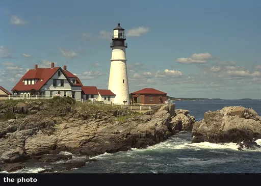

# Lighthouse demo



**Edited by an AI agent.** An AI agent made every edit below by calling this MCP server's tools:
it chose the image and the story, built the selections, picked the parameters and captions, and
checked the previews the tools returned before settling on the plan.

**Image.** Kodak test image 21 (a lighthouse on a rocky shore, 768×512), stored as
`data/lighthouse/lighthouse.png` and fitted with 267,456 Gaussians.

**Use case.** A quiet afternoon at the lighthouse gets a sunset, blue roofs and a whirlpool. Then
the lighthouse steps out of the picture (a camera tilt proves it), gets a free twin, both lamps
come on, and the original grows a big head to stay the taller one.

Run it with

```bash
curl -L --create-dirs -o data/lighthouse/lighthouse.png https://r0k.us/graphics/kodak/kodak/kodim21.png
uv run python scripts/mcp_session.py docs/demo/lighthouse_plan.json --out previews/lighthouse
```

The replay writes `previews/lighthouse/lighthouse.webp`; the one shown here is `docs/demo/lighthouse.webp`
(512 px wide, 281 frames at 20 fps, about 14 s, 2.6 MB, animated WebP).
`lighthouse_keyframes.png` shows six of its frames.

## Selections

| Selection | How it is built |
|---|---|
| `sky` | a box above the horizon (drawn wider than the image, so large sky Gaussians centred outside the frame are included), minus a polygon that traces the roofline and the tower; then `mode="add"` with six sky colours (pale and dark blues, tolerance 0.08–0.15) to take back the sky that shows inside the tower outline; then minus a polygon around the houses only, intersect with the first box, and minus a box on the lantern glass |
| `roofs` | `shape="color"` with roof red `[0.5, 0.25, 0.2]`, tolerance 0.2, then `mode="intersect"` with a box around the buildings (the colour alone also matches the brown rocks) |
| `tower` | a 19-point polygon along the outline of the lighthouse, minus the same six sky colours, plus the lantern box back (the glass is sky-coloured) |
| `lamp` | a box on the lantern glass; after the twin exists, `mode="add"` with a box on the twin's lantern, then minus the sunset orange `[0.8, 0.54, 0.39]` (tolerance 0.25) so the sky behind the twin stays out |

`sky`, `roofs` and `tower` are made before the first edit; `lamp` is extended after step 6,
because a selection made earlier never contains Gaussians added later by `duplicate`. A selection
is a set of Gaussians, so `lamp` still points at the lantern after the tower has been lifted,
scaled and bulged.

## Steps

| # | Tool | Selection | Op and params | Caption |
|---|---|---|---|---|
| 0 | `start_recording` | | `frames_per_edit=14, hold_frames=10, intro=True` | *the photo*, then the Gaussians growing in |
| 1 | `edit` | `sky` | `recolor` tint `[1.0, 0.5, 0.2]`, tint_strength 0.6, saturation 1.3 | Golden hour, on demand |
| 2 | `edit` | `roofs` | `recolor` hue 215, saturation 1.2 | Repaint the roofs. No ladder needed |
| 3 | `edit` | `all` | `swirl` cx 0.6, cy 0.865, radius 0.085, degrees 300 | Somebody pulled the plug |
| 4 | `edit` | `tower` | `lift` amount 0.18 | Lighthouse, one step forward please |
| 5 | `edit` | `all` | `camera` yaw 0, pitch 5, zoom 1.06 | Tilt the view: it really stepped out |
| 6 | `edit` | `tower` | `duplicate` dx 0.42, dy 0.035 | Buy one, get one free |
| – | `select_region` | `lamp` | add the twin's lantern box, subtract the sunset orange | |
| 7 | `edit` | `lamp` | `recolor` brightness 1.8, tint `[1.9, 1.85, 1.0]`, tint_strength 0.9 | Lights on, both of them |
| 8 | `edit` | `tower` | `scale` fx 1.1, fy 1.12 about the base (cx 0.458, cy 0.595) | Sibling rivalry: the original grows |
| 9 | `edit` | `tower` | `bulge` cx 0.455, cy 0.2, radius 0.09, strength 0.9 | ...and gets a big head about it |
| 10 | `edit` | `all` | `camera` yaw 0, pitch 0, zoom 1 | Good night! |
| 11 | `stop_recording` | | `fps=20, orbit_finale=False, width=512` | |

## Tricks

- **Colour and region together.** The roofs are a colour selection intersected with a box. The
  sky is mostly a box minus a polygon, because the sky and the grey walls are too close in colour
  to separate by colour alone. Near the tower, where a polygon cannot follow the railings, sky
  colours are added to `sky` and subtracted from `tower`, so the light-blue rim that used to
  travel with the tower now stays behind and turns orange with the rest of the sky.
- **A camera tilt shows the lift.** Lifting the tower toward the viewer (step 4) only makes it a
  little larger from the front. The `camera` step tilts the view by 5°, and the tower slides down
  over the fence and the rocks, so it visibly stands in front of the picture. The copy inherits
  the lift, and the view stays tilted until the last step returns it to the front.
- **Pitch, not yaw.** A sideways turn opens a dark gap beside the lifted tower, where its
  Gaussians used to be. A small pitch moves the tower along its own length, so the gap stays
  hidden behind the tower and the sky Gaussians left in the plane. Zoom 1.06 is enough to hide
  the image edges at 5° and keeps the big head inside the frame.
- **Select after duplicating.** The twin's Gaussians exist only after step 6, so its lantern is
  added to `lamp` then, with the sunset orange subtracted so a large sky Gaussian behind the twin
  does not light up.
- **No holes.** Every edit either stays in place (recolour, bulge, swirl), covers more than it
  did before (scale up about the base, bulge), adds something (duplicate), or moves the view.
  The tower's lowest strip and its edge behind the roof are left out of `tower`, so they stay in
  place under the lifted tower instead of leaving gaps.
- **Tint above 1.** The lantern has dark parts, so the tint uses values above 1 to make the whole
  lantern glow.

## Limitations seen here

- The tilted view is a little softer than the front view, because the fitted Gaussians are
  spread slightly in depth.
- The lamps glow white-cream rather than yellow (chosen when the recording was a GIF with one
  shared palette, in which a small yellow area came out peach against the sky).
- A few cyan specks from the sky seen through the gallery railing still travel with the tower,
  and a faint white glare sits beside the bulged head.
