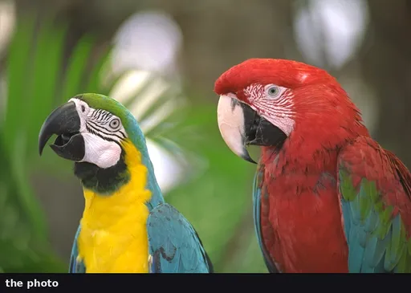

# Parrots demo



**Edited by an AI agent.** An AI agent made every edit below by calling this MCP server's tools:
it chose the image and the story, built the selections, picked the parameters and captions, and
checked the previews the tools returned before settling on the plan.

**Image.** Kodak test image 23 (two parrots, 768×512), stored as `data/parrots/parrots.png` and
fitted with 80,428 Gaussians.

**Use case.** A picture made of Gaussians can do things a pixel editor cannot. Here one parrot
breaks into its splats, is repainted while the pieces are in the air, flies back together as a
blue macaw, and then steps out of the picture plane.

Run it with

```bash
curl -L --create-dirs -o data/parrots/parrots.png https://r0k.us/graphics/kodak/kodak/kodim23.png
uv run python scripts/mcp_session.py docs/demo/parrots_plan.json --out previews/parrots
```

The replay writes `previews/parrots/parrots.webp`; the one shown here is `docs/demo/parrots.webp`
(512 px wide, 146 frames at 20 fps, about 7 s, 2.0 MB, animated WebP).
`parrots_keyframes.png` shows six of its frames.

## Selections

| Selection | How it is built |
|---|---|
| `red` | a 20-point polygon along the outline of the red macaw (head, beak, body and wing) |
| `feathers` | `shape="color"` with red `[0.7, 0.12, 0.1]`, tolerance 0.5, then `mode="add"` with a lighter red `[0.85, 0.35, 0.35]`, tolerance 0.3 (the top of the head), then `mode="intersect"` with the same polygon as `red` |

Both are made before the first edit. `feathers` keeps the white face, the black beak and the
green and blue wing feathers out of the recolour, so only the red plumage turns blue. A
selection is a set of Gaussians, so it still points at the same splats while they are scattered.

## Steps

| # | Tool | Selection | Op and params | Caption |
|---|---|---|---|---|
| 0 | `start_recording` | | `frames_per_edit=12, hold_frames=9, intro=True` | *the photo*, then the Gaussians growing in |
| 1 | `edit` | `red` | `scatter` strength 0.35, toward 0.6, gravity 0.1, fade 0.3, seed 1 | The red macaw flies apart |
| 2 | `edit` | `feathers` | `recolor` hue 215, saturation 0.85 | Repaint the pieces in mid-air |
| 3 | `edit` | `red` | `scatter` strength −0.35, toward 0.6, gravity −0.1, fade −0.428571, seed 1 | ...and they fly back, now blue |
| 4 | `edit` | `all` | `camera` yaw −12, pitch 5, zoom 1.15 | Turn the view a little |
| 5 | `edit` | `red` | `lift` amount 0.07 | The blue macaw steps forward |
| 6 | `stop_recording` | | `fps=20, orbit_finale=False, width=512` | |

## Tricks

- **Reassemble with a new colour.** `undo` after a `scatter` would also undo anything done while
  the pieces are apart. Instead, step 3 is a second `scatter` with the same seed and the
  opposite strength and gravity, which moves every splat exactly back. Its fade
  (1 − 1/0.7 ≈ −0.43) restores the opacity the first scatter took away. The recolour in between
  stays on the stack, so the bird lands blue.
- **Colour inside a polygon.** The polygon alone would also turn the green wing feathers
  magenta. Intersecting it with two red colour selections recolours only the red plumage.
- **Turn first, then lift.** A `lift` barely shows from the front. Doing it after the `camera`
  step makes the macaw slide forward against the background, so the depth is visible.
- **Fewer beats.** Scattered frames are busy and cost a lot of file size, so the story keeps one
  scatter and its return instead of adding more edits.

## Limitations seen here

- While the macaw is apart, the area behind it shows only a dark silhouette: the photo has no
  background behind the bird, so nothing fills it until the pieces return.
- The hue rotation passes through green on its way from red to blue, so the pieces turn
  greenish for a moment in step 2.
- A few mixed red and green wing Gaussians fall inside `feathers` and turn purple.
- The recording ends with the view still turned.
